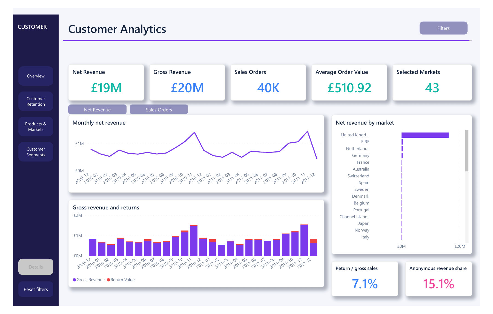

# Customer Analytics

Customer segmentation, retention and returns analysis using 1,067,371 source rows from UCI Online Retail II, covering December 2009 to December 2011.



**Python · MySQL · Power BI · Power Query · DAX**

## Results

- GBP 19.01 million net revenue across 40,077 sales invoices.
- The top customer decile accounts for 63.93% of identified gross purchase spend.
- Anonymous purchases contribute 15.15% of gross revenue and remain in revenue totals.

## Analysis

The pipeline checks duplicates, invalid records and signed returns before creating customer, product and date tables. RFM segments and monthly cohorts support customer comparisons; product and country analyses show where sales and returns concentrate.

The four-page Power BI report contains 26 DAX measures, page navigation, metric views, tooltips and drillthrough. Its F-shaped overview separates revenue trends and returns from market contribution.

## Explore

- [21 SQL analyses](sql/analysis_queries.sql) and [database schema](sql/schema.sql)
- [Analysis notebook](notebooks/01_analysis.ipynb) and [Python pipeline](src/pipeline.py)
- [Power BI project](powerbi/Customer_Intelligence.pbip) and [DAX measures](powerbi/measures.dax)
- [Customer segment comparison](reports/figures/comparison_review.png)
- [Data dictionary](reports/DATA_DICTIONARY.md), [cleaning rules](reports/DATA_QUALITY.md) and [measure definitions](powerbi/MEASURE_DEFINITIONS.md)

## Run locally

Use Python 3.11+ and download the source workbook separately.

```bash
pip install -r requirements.txt
python src/pipeline.py --source "path/to/online_retail_II.xlsx"
python src/comparison_analysis.py
python -m pytest tests -q
```

For MySQL 8, create an empty local database, set the `DATABASE_URL` environment variable using the format in `.env.example`, enable LOCAL INFILE and run `python src/database.py`. SQL query results are saved under `reports/sql_results/`.

Open `powerbi/Customer_Intelligence.pbip` in Power BI Desktop. Set `DataRoot` to the generated `data/` folder with a trailing slash, then refresh. Light and dark themes are in `powerbi/themes/`.

## Data notes

RFM is a full-period snapshot at 10 December 2011. Anonymous and return-only customers are excluded from RFM; first observed purchase defines each cohort. December 2011 is partial. Returns are measured within the reporting period rather than matched to their original invoices.

Source: [UCI Online Retail II](https://archive.ics.uci.edu/dataset/502/online+retail+ii), Daqing Chen, DOI 10.24432/C5CG6D, CC BY 4.0. Cleaning steps modify the source records as described above. Code is covered by [MIT](LICENSE); data retains its source license.
